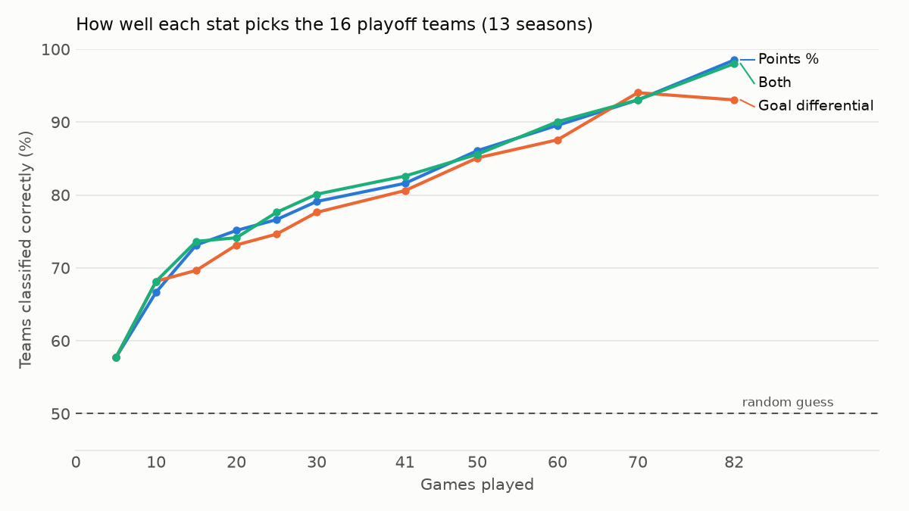

# How early can you call the NHL playoff race?


After 10 or 20 games, how well does a team's record predict whether it makes the
playoffs? And is goal differential a better early signal than the standings
themselves? This project answers both with every regular-season game from 13 full
NHL seasons, then uses the result to give playoff odds for the season in progress.



Full results: [`outputs/findings.md`](outputs/findings.md) ·
Current season: [`outputs/current_odds.md`](outputs/current_odds.md)

## Data

`nhl/fetch.py` downloads every team's schedule and results from the NHL's public web
API (`api-web.nhle.com`) and builds two tables:

- `data/games.csv`: one row per completed regular-season game (teams, score, and
  whether it ended in regulation, overtime or a shootout)
- `data/teams.csv`: one row per team-season with its conference and whether it
  made the playoffs

Seasons 2010-11 to 2025-26 are included except 2012-13 (48-game lockout season),
2019-20 (stopped at about 70 games) and 2020-21 (56 games in temporary divisions),
so every season is 82 games under the same points rules. The fetch step checks
that each completed season has 82 games per team and exactly 16 playoff teams, and
stops if not.

## Method

1. **Season-to-date stats.** For every team after N games: points percentage
   (points earned out of points available) and goal differential per game.
   Rates rather than totals keep teams comparable at the same point in the season.
2. **Three predictors**, each a logistic regression: points % alone (what the
   standings show), goal differential alone, and both together.
3. **Leave-one-season-out cross-validation.** Each season is predicted by a model
   trained only on the other seasons, so no season helps predict itself.
4. **Playoff format.** Eight teams per conference make it, so a team is predicted
   in when it ranks top 8 in its conference by predicted probability. Accuracy is
   the share of all teams classified correctly; a random guess scores 50%.
   Brier scores measure how well calibrated the probabilities are.

## Run it

```bash
pip install -r requirements.txt
python -m nhl.fetch      # downloads about 430 team schedules (cached in data/raw/)
python -m nhl.analyze    # writes outputs/results.csv, findings.md and the chart
python -m nhl.odds       # playoff odds for the season in progress
pytest                   # unit tests plus an end-to-end run on a synthetic league
```

Re-run `fetch` and `odds` during the season to update the current odds.

## Project structure

```
nhl/
  fetch.py      API download, caching and data checks
  features.py   game results to season-to-date stats after N games
  model.py      logistic regression, cross-validation, top-8-per-conference picks
  analyze.py    runs the study, writes the chart and findings
  odds.py       current-season playoff odds
tests/
  synthetic.py  fake 32-team league with the same shape as the real data
  test_nhl.py
```

## Limitations

- Only points % and goal differential are used. Shot-based stats such as expected
  goals would likely be stronger early signals but need play-by-play data.
- Teams are treated as independent within a season, so the current odds don't
  account for remaining schedule strength.
